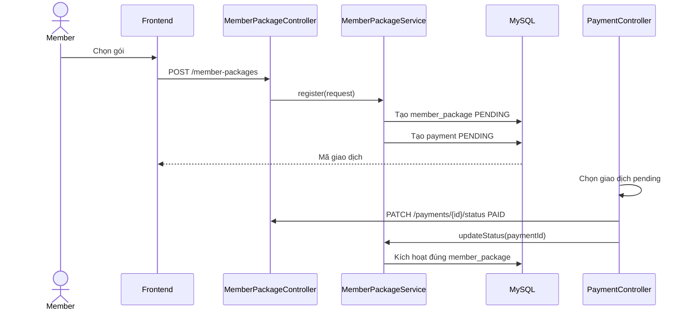
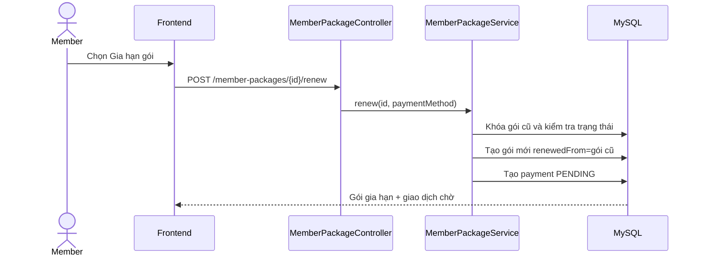
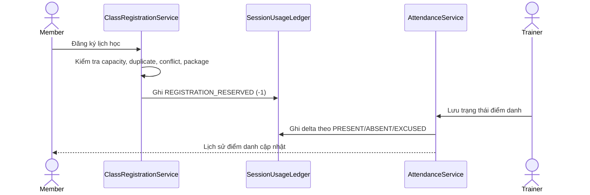

# Phân tích và thiết kế hệ thống

## 1. Kiến trúc tổng thể

```text
Browser / Vanilla HTML-CSS-JS
        |
        | REST/JSON + JWT
        v
Spring Boot API
  Controller -> Service -> Repository -> JPA Entity
        |                              |
        +-- Security/RBAC              +-- MySQL 8
        +-- Validation                 +-- Flyway migrations
        +-- Audit + transaction
```

Frontend tách thành `api.js` (HTTP/JWT refresh), `repository.js` (mapping nghiệp vụ), `state.js` (session) và các view trong `app.js`/`advanced-pages.js`. Backend tách DTO request/response để không expose trực tiếp entity.

## 2. Subsystem

| Subsystem | Thành phần chính |
|---|---|
| Authentication | `AuthController`, `AuthService`, JWT filter, refresh/revoked token |
| Member & staff | `MemberController`, `EmployeeController`, profile và RBAC |
| Package & payment | `MemberPackageService`, `PaymentService`, `Payment`, `MemberPackage` |
| Class & registration | `ClassManagementService`, `ClassRegistrationService` |
| Attendance | `AttendanceService`, session usage ledger |
| Reporting | `ReportService`, dashboard services, date-range overview |
| Audit | `AuditService`, `AuditController`, audit log repository |

## 3. Sequence: đăng ký và thanh toán gói



## 4. Sequence: gia hạn gói



## 5. Sequence: đăng ký lớp và điểm danh



## 6. Thiết kế báo cáo

`GET /reports/overview` nhận `from` và `to`. Service quy đổi ngày theo `Asia/Ho_Chi_Minh`, giới hạn khoảng tối đa hai năm, sau đó tổng hợp hội viên, gói hết hạn, lịch học, đăng ký, điểm danh, giao dịch, doanh thu PAID và tỷ lệ lấp đầy.
